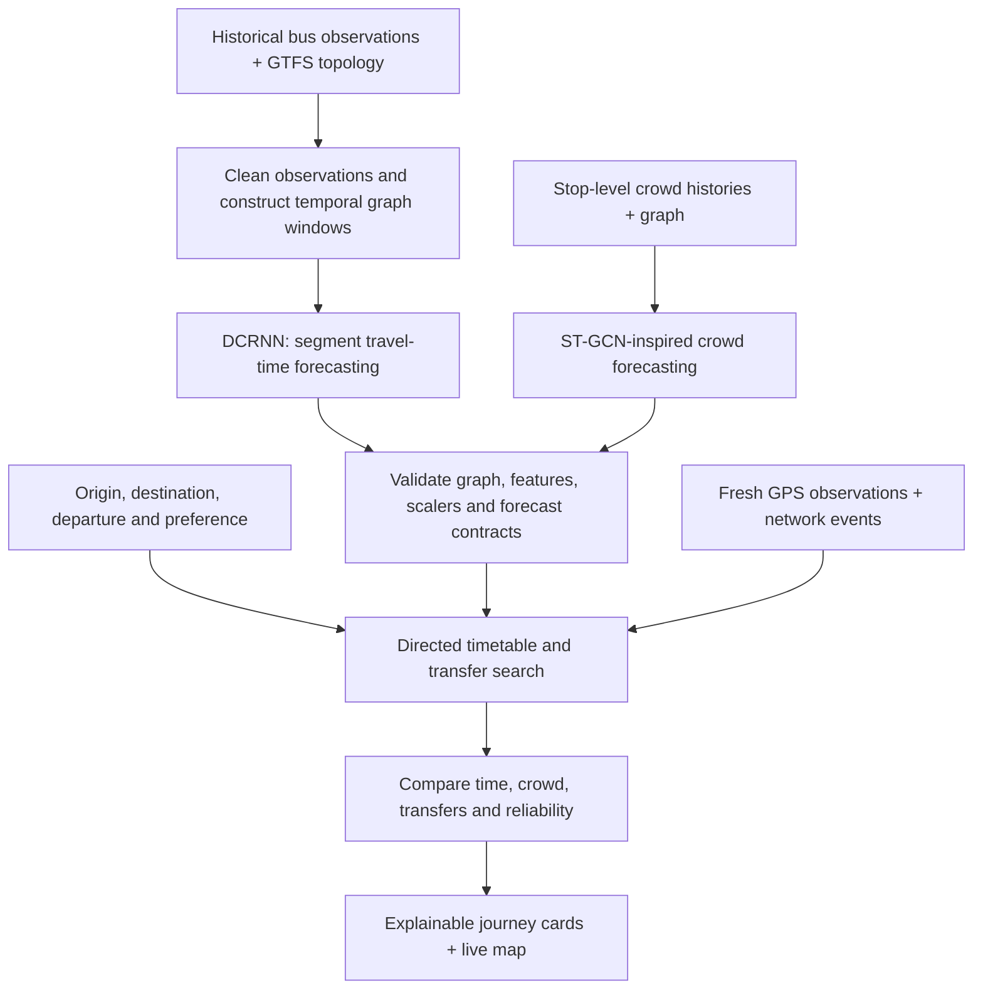

<div align="center">

# BusAI · BusSure

### Research-informed bus journey planning with spatiotemporal deep learning

Predict travel conditions. Compare journeys. Understand the trade-offs.

**Deep Learning · Graph Neural Networks · Intelligent Transportation Systems**

[Problem](#problem-statement) · [Solution](#our-solution) · [Methodology](#methodology) · [Dataset](#dataset-salvador-urban-network-transportation-sunt) · [Research papers](#10-research-papers-and-their-connection-to-busai) · [Run locally](#run-locally)

</div>

---

## Problem statement

A bus passenger needs more than a route between two stops. They need to decide **which journey to take, how long it may take, how crowded it may be, and whether a transfer is practical**.

Timetables provide scheduled service, while GPS observations provide vehicle positions. Turning those inputs into useful journey advice requires accounting for changing travel times, relationships between connected stops, passenger-demand patterns and disruptions. A delay on one segment can affect downstream boarding and transfer choices.

**BusAI investigates how graph-based travel-time and crowd forecasts can support understandable, preference-aware bus journey comparisons.**

## Our solution

BusAI, presented in the application as **BusSure**, brings forecasting, journey search and live vehicle visualization into one passenger interface.

| Passenger need | What BusAI provides |
|---|---|
| Find a suitable journey | Direct and transfer options using stop, route and timetable information |
| Anticipate travel conditions | DCRNN-based segment travel-time forecasting and ST-GCN-inspired crowd forecasting |
| Choose between alternatives | Comparisons for faster travel, lower crowd and an explainable reliability index |
| Understand a recommendation | Walking, waiting, riding, transfers and disruption effects shown separately |
| Follow a vehicle | Source-labelled GPS markers, next-stop information and stale-data handling |
| Explore a disruption | What-if scenarios for congestion, demand, delays and roadblocks |
| Describe a journey in plain language | A rule-based assistant that extracts supported stop, time and preference details |

## Research gap and project contribution

The forecasting papers below study ways to capture relationships across a transport network and over time. BusAI explores the next application step: **using forecasts inside a passenger journey workflow**, where walking, waiting, crowd, transfers and disruptions affect the decision.

The implemented contribution is a reproducible integration of graph forecasting, bounded timetable search, preference-based comparison and visible explanations. It includes data/model contracts, chronological evaluation and explicit fallback behaviour.

This is an applied research prototype. A new graph-learning architecture, superiority over published methods, and generalization across cities have not been established. The research question is whether combining these components improves passenger decisions; controlled experiments are needed to establish that benefit.

## Methodology



### 1. Represent the transport network as a graph

Travel-time nodes represent directed stop-to-stop segments; crowd nodes represent stops. Graph connections encode the supplied network structure. Timestamped histories form the temporal input windows.

### 2. Forecast segment travel time with DCRNN

The [DCRNN V2 implementation](ml/travel_time/dcrnn_v2/model.py) combines forward/backward random-walk diffusion with graph-convolutional recurrent units and an encoder–decoder. This follows the architectural ideas in paper **[1]**, adapted to segment travel-time targets. It is a local implementation, not a claim of exact reproduction of the paper's experiments.

### 3. Forecast crowd using an ST-GCN-inspired model

The [crowd model](ml/synthetic/models.py) combines gated temporal convolutions with adjacency-based graph aggregation. Paper **[2]** motivates modelling spatial and temporal dependencies together. The implementation is a simplified adaptation for stop-level occupancy ratios; it does not reproduce the original spectral STGCN architecture exactly.

### 4. Search feasible journeys and explain the ranking

The [journey service](backend/app/services/ai_journey_service.py) searches directed timetable paths with bounded transfers, walking access, service-date checks and transfer buffers. Forecasts and scoped disruption rules affect the journey estimates. Short-horizon forecasts are held fixed over an itinerary as a planning assumption.

The interface exposes the components behind each result. Its reliability index is a deterministic planning score, and its what-if effects are explicit scenario rules. They are not learned probabilities or causal predictions.

## Dataset: Salvador Urban Network Transportation (SUNT)

The real-data travel-time development experiment uses **Salvador Urban Network Transportation (SUNT)**, a public-transport dataset from Salvador, Brazil.

- **Official source:** [LabIA-UFBA / SUNT](https://github.com/LabIA-UFBA/SUNT)
- **Field documentation:** [SUNT dataset documentation](https://github.com/LabIA-UFBA/SUNT/blob/main/docs/datasets.md)
- **Available data families:** automatic vehicle location (AVL), automatic fare collection (AFC) and GTFS network/schedule files.
- **Used in the travel-time experiment:** timestamped AVL observations and BUS GTFS topology. AFC records are not used to create its travel-time labels.

The retained development subset contains **8,132 derived traversals across nine connected directed segments**. The target is the elapsed time from the last upstream-stop observation to the first downstream-stop observation. It is an **AVL-derived stop-transition estimate**, with sampling uncertainty, rather than verified door-event travel time.

The adapter filters invalid transitions and implausible durations, preserves vehicle/day boundaries, and documents its timestamp assumptions. The retained subset, preprocessing code, configuration and checkpoint provenance are included under [DCRNN V2](ml/travel_time/dcrnn_v2/).

**Application data scope:** the runnable Chennai showcase uses a separate generated network and temporal histories for its integrated crowd/travel forecasts. The SUNT checkpoint powers the historical Salvador demonstration; it does not supply Chennai predictions. SUNT-based end-to-end crowd forecasting and live city deployment remain future work. See [dataset provenance](docs/datasets.md) for the separate data contracts.

## 10 research papers and their connection to BusAI

The links below provide freely accessible papers through arXiv, an author-hosted PDF or open conference proceedings. Papers **[1]–[2]** directly motivate the implemented forecasting methods. Papers **[3]–[4]** provide graph-learning foundations; **[5]–[10]** are related methods for future comparison or extension. Citing them does not mean all ten models are implemented or benchmarked.

| Ref. | Paper and accessible link | Connection to this project |
|---|---|---|
| **[1]** | **Li et al. — Diffusion Convolutional Recurrent Neural Network: Data-Driven Traffic Forecasting**, ICLR 2018. [Read paper](https://arxiv.org/abs/1707.01926) | Directed diffusion and recurrent temporal modelling underpin DCRNN V2 segment travel-time forecasting. |
| **[2]** | **Yu, Yin & Zhu — Spatio-Temporal Graph Convolutional Networks: A Deep Learning Framework for Traffic Forecasting**, IJCAI 2018. [Read paper](https://arxiv.org/abs/1709.04875) | Motivates the crowd model's temporal convolution and graph aggregation; BusAI adapts the idea to a different prediction target. |
| **[3]** | **Defferrard, Bresson & Vandergheynst — Convolutional Neural Networks on Graphs with Fast Localized Spectral Filtering**, NeurIPS 2016. [Read paper](https://arxiv.org/abs/1606.09375) | Background for localized graph filtering and the spectral graph-convolution literature behind STGCN. Chebyshev filtering is not implemented in BusAI's simplified crowd model. |
| **[4]** | **Kipf & Welling — Semi-Supervised Classification with Graph Convolutional Networks**, ICLR 2017. [Read paper](https://arxiv.org/abs/1609.02907) | Foundational context for neighbourhood aggregation. Its node-classification task is distinct from BusAI's temporal regression tasks. |
| **[5]** | **Zhao et al. — T-GCN: A Temporal Graph Convolutional Network for Traffic Prediction**, IEEE Transactions on Intelligent Transportation Systems, 2020. [Read paper](https://arxiv.org/abs/1811.05320) | A candidate comparison for combining graph convolution with gated recurrent units. Not currently benchmarked here. |
| **[6]** | **Guo et al. — Attention Based Spatial-Temporal Graph Convolutional Networks for Traffic Flow Forecasting**, AAAI 2019. [Read paper](https://guoshnbjtu.github.io/pdfs/AAAI2019-GuoS.2690.pdf) | Motivates future attention-based weighting of locations and temporal patterns. BusAI does not currently implement ASTGCN attention. |
| **[7]** | **Wu et al. — Graph WaveNet for Deep Spatial-Temporal Graph Modeling**, IJCAI 2019. [Read paper](https://arxiv.org/abs/1906.00121) | Motivates comparing a learned adaptive graph and dilated temporal convolutions against the current supplied topology. |
| **[8]** | **Zheng et al. — GMAN: A Graph Multi-Attention Network for Traffic Prediction**, AAAI 2020. [Read paper](https://arxiv.org/abs/1911.08415) | A future multi-attention forecasting comparison, especially for multi-step temporal dependencies. |
| **[9]** | **Bai et al. — Adaptive Graph Convolutional Recurrent Network for Traffic Forecasting**, NeurIPS 2020. [Read paper](https://arxiv.org/abs/2007.02842) | Motivates testing node-specific parameters and learned graph relationships instead of a fixed graph alone. |
| **[10]** | **Song et al. — Spatial-Temporal Synchronous Graph Convolutional Networks: A New Framework for Spatial-Temporal Network Data Forecasting**, AAAI 2020. [Read paper](https://ojs.aaai.org/index.php/AAAI/article/download/5438/5294) | Motivates a future comparison with jointly modelled local spatial and temporal interactions. |

Most of these forecasting studies use road-sensor traffic targets. Applying their ideas to bus segment times or occupancy requires task-specific data preparation and evaluation; their published results do not transfer automatically to BusAI.

## Experimental design and reproducibility

The repository includes training, saved configurations, provenance manifests and evaluation code. This overview intentionally omits model performance figures.

| Research requirement | Current implementation and remaining work |
|---|---|
| Data preparation | SUNT adapter derives directed segment observations from AVL and GTFS; target uncertainty is recorded. |
| Temporal evaluation | Chronological train/validation/test partitions and training-only scaler fitting reduce future-data leakage. |
| Baseline | Persistence is included in the forecasting evaluation. Comparisons with the other research models remain future work. |
| Configuration | Saved seeds, window sizes, model dimensions, optimizer settings and artifact hashes support reproduction. |
| Model selection | Validation data selects checkpoints; held-out test data is reserved for evaluation. |
| Generalization | Unseen-route, cross-city and varied traffic-condition evaluation remain to be established. |
| End-to-end benefit | Controlled studies of journey decisions, missed transfers and user experience remain future work. |

### Reproduce the SUNT development experiment

From the repository root, install the SUNT dependencies and use the retained connected subset:

```sh
.venv/bin/python -m pip install -r ml/travel_time/dcrnn_v2/sunt_requirements.txt

.venv/bin/python -B -m ml.travel_time.dcrnn_v2.train \
  --observations ml/travel_time/dcrnn_v2/sunt_connected_subset/segment_traversals.csv \
  --gtfs ml/travel_time/dcrnn_v2/sunt_connected_subset/gtfs \
  --config ml/travel_time/dcrnn_v2/sunt_dev_config.json --inspect

.venv/bin/python -B -m ml.travel_time.dcrnn_v2.sunt_experiment \
  --subset ml/travel_time/dcrnn_v2/sunt_connected_subset \
  --output output/sunt_reproduction

.venv/bin/python -B -m ml.travel_time.dcrnn_v2.inference \
  --artifacts output/sunt_reproduction --sample
```

These commands reproduce the bounded development experiment, not full-network SUNT training. See the [SUNT preparation and experiment report](ml/travel_time/dcrnn_v2/sunt_reports/report.md), [saved development configuration](ml/travel_time/dcrnn_v2/sunt_dev_config.json) and [cloud reproduction notes](ml/travel_time/dcrnn_v2/SUNT_CLOUD.md) for details. Linked experiment reports contain technical evaluation outputs.

## Technology stack

| Layer | Technologies |
|---|---|
| Passenger interface | React, Vite, Leaflet, React-Leaflet |
| API and live updates | FastAPI, Pydantic, Uvicorn, WebSockets |
| Deep learning | PyTorch, DCRNN V2, ST-GCN-inspired crowd model |
| Data processing | NumPy, pandas, GTFS, SUNT AVL/Parquet adapter |
| Verification | Python unittest, Node tests, Playwright |

## Run locally

Use Python 3.9+ and Node 22.12+. From the repository root:

```sh
python3 -m venv .venv
.venv/bin/python -m pip install -r backend/requirements.txt
.venv/bin/python -m pip install -r ml/synthetic/requirements.txt
```

Start the backend:

```sh
GTFS_DIR=datasets/synthetic_chennai .venv/bin/python -B -m uvicorn \
  app.main:app --app-dir backend --port 8000
```

In a second terminal, start the frontend:

```sh
cd frontend
npm ci
npm run dev
```

For moving demonstration vehicles, run in a third terminal:

```sh
.venv/bin/python -B simulator/multi_bus_simulator.py \
  --config datasets/synthetic_chennai/simulator.json
```

Open **[http://localhost:5173](http://localhost:5173)**. Backend API documentation is at **[http://localhost:8000/docs](http://localhost:8000/docs)**.

Try **Start journey → AI Journey** and enter `Take me to Stop G at 08:00 with low crowd and fewer transfers.` Choose Madipakkam when asked for an origin. Plan a journey before exploring the What-If Studio. The historical model demonstration uses the saved SUNT bundle and its matching Python dependencies.

### Verification commands

```sh
.venv/bin/python -B -m unittest discover -s backend/tests -v
.venv/bin/python -B -m unittest \
  ml.travel_time.dcrnn_v2.test_pipeline \
  ml.travel_time.dcrnn_v2.test_sunt \
  ml.synthetic.test_retraining -v
node scripts/test_phone_page.js
cd frontend
npm test
npm run build
```

These are verification instructions, not a claim that every check was rerun for this README update.

## Project structure

```text
backend/                  FastAPI APIs, journey search, GPS and forecasting services
frontend/                 React passenger app and map
ml/travel_time/dcrnn_v2/   DCRNN model, SUNT adapter, subset and experiment artifacts
ml/crowd/                 Earlier crowd-model training artifacts
ml/synthetic/             Integrated showcase forecasting models and histories
simulator/                Demonstration vehicle movement
scripts/                  Data generation and network verification utilities
docs/                     Architecture, provenance, API and verification guides
```

## Scope and future research

BusAI currently runs as a local, single-worker prototype with in-memory operational state. Live operator integration, durable storage, authentication, road-aware routing and physical-phone validation require further development. The assistant uses rules; an LLM, RAG system or autonomous agent is not part of the implemented workflow.

Research extensions include SUNT-based crowd/boarding targets, consistent comparisons against the related models, ablations of graph and temporal components, longer forecast horizons, unseen-route evaluation and uncertainty calibration. A publication-ready study needs those experiments and a substantiated contribution beyond application integration.

## Documentation

[Architecture](docs/architecture.md) · [Dataset provenance](docs/datasets.md) · [Model integration](docs/model_integration.md) · [API reference](docs/api_reference.md) · [Showcase guide](docs/showcase.md) · [Startup guide](docs/synthetic_end_to_end.md) · [Phone GPS and networking](docs/gps_networking_audit.md)
