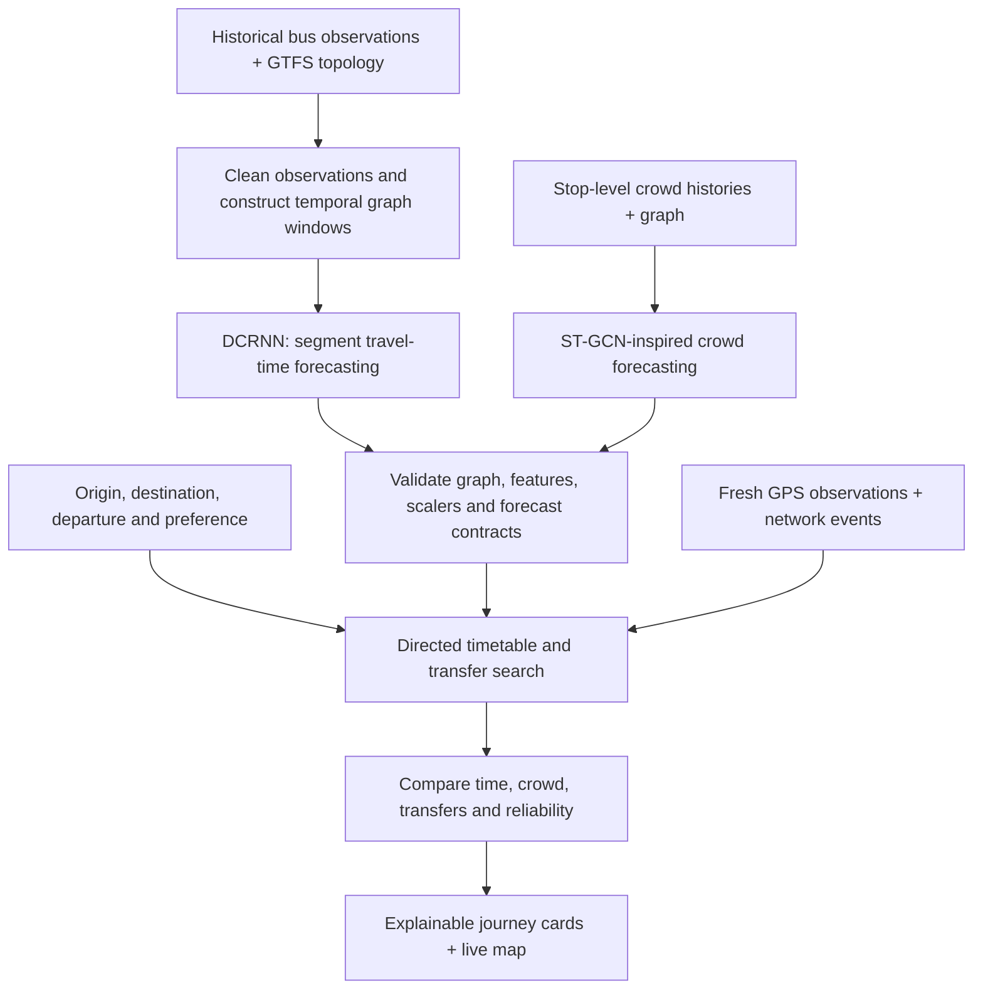

<div align="center">

# BusAI · BusSure

### Research-informed bus journey planning with spatiotemporal deep learning

Predict travel conditions. Compare journeys. Understand the trade-offs.

**Deep Learning · Graph Neural Networks · Intelligent Transportation Systems**

[Problem](#problem-statement) · [Solution](#our-solution) · [Methodology](#methodology) · [Dataset](#dataset-salvador-urban-network-transportation-sunt) · [Journal articles](#10-journal-articles-and-their-connection-to-busai) · [Run locally](#run-locally)

</div>

---

## Problem statement

A bus passenger needs more than a route between two stops. They need to decide **which journey to take, how long it may take, how crowded it may be, and whether a transfer is practical**.

Timetables provide scheduled service, while GPS observations provide vehicle positions. Turning those inputs into useful journey advice requires accounting for changing travel times, relationships between connected stops, passenger-demand patterns and disruptions. A delay on one segment can affect downstream boarding and transfer choices.

**BusAI investigates how graph-based travel-time and crowd forecasts can support understandable, preference-aware bus journey comparisons.**

## Our solution

BusAI, presented in the application as **BusSure**, brings forecasting, journey search and live vehicle visualization into one passenger interface.

| Passenger need | What BusAI provides |
|---|---|
| Find a suitable journey | Direct and transfer options using stop, route and timetable information |
| Anticipate travel conditions | DCRNN-based segment travel-time forecasting and ST-GCN-inspired crowd forecasting |
| Choose between alternatives | Comparisons for faster travel, lower crowd and an explainable reliability index |
| Understand a recommendation | Walking, waiting, riding, transfers and disruption effects shown separately |
| Follow a vehicle | Source-labelled GPS markers, next-stop information and stale-data handling |
| Explore a disruption | What-if scenarios for congestion, demand, delays and roadblocks |
| Describe a journey in plain language | A rule-based assistant that extracts supported stop, time and preference details |

## Research gap and project contribution

The journal articles below study ways to capture relationships across a transport network and over time. BusAI explores the next application step: **using forecasts inside a passenger journey workflow**, where walking, waiting, crowd, transfers and disruptions affect the decision.

The implemented contribution is a reproducible integration of graph forecasting, bounded timetable search, preference-based comparison and visible explanations. It includes data/model contracts, chronological evaluation and explicit fallback behaviour.

This is an applied research prototype. A new graph-learning architecture, superiority over published methods, and generalization across cities have not been established. The research question is whether combining these components improves passenger decisions; controlled experiments are needed to establish that benefit.

## Methodology



### 1. Represent the transport network as a graph

Travel-time nodes represent directed stop-to-stop segments; crowd nodes represent stops. Graph connections encode the supplied network structure. Timestamped histories form the temporal input windows.

### 2. Forecast segment travel time with DCRNN

The [DCRNN V2 implementation](ml/travel_time/dcrnn_v2/model.py) combines forward/backward random-walk diffusion with graph-convolutional recurrent units and an encoder–decoder. It adapts the DCRNN architecture to segment travel-time targets. Journal articles **[1], [2] and [3]** provide related graph-based forecasting and travel-time research; they are not the original DCRNN source or exact descriptions of this implementation.

### 3. Forecast crowd using an ST-GCN-inspired model

The [crowd model](ml/synthetic/models.py) combines gated temporal convolutions with adjacency-based graph aggregation. The implementation is a simplified ST-GCN-inspired adaptation for stop-level occupancy ratios; it does not reproduce the original spectral STGCN architecture exactly. Journal articles **[5] and [6]** address related passenger-flow tasks and motivate future evaluation with observed passenger data; their models are not implemented here.

### 4. Search feasible journeys and explain the ranking

The [journey service](backend/app/services/ai_journey_service.py) searches directed timetable paths with bounded transfers, walking access, service-date checks and transfer buffers. Forecasts and scoped disruption rules affect the journey estimates. Short-horizon forecasts are held fixed over an itinerary as a planning assumption.

The interface exposes the components behind each result. Its reliability index is a deterministic planning score, and its what-if effects are explicit scenario rules. They are not learned probabilities or causal predictions.

## Dataset: Salvador Urban Network Transportation (SUNT)

The real-data travel-time development experiment uses **Salvador Urban Network Transportation (SUNT)**, a public-transport dataset from Salvador, Brazil.

- **Official source:** [LabIA-UFBA / SUNT](https://github.com/LabIA-UFBA/SUNT)
- **Field documentation:** [SUNT dataset documentation](https://github.com/LabIA-UFBA/SUNT/blob/main/docs/datasets.md)
- **Available data families:** automatic vehicle location (AVL), automatic fare collection (AFC) and GTFS network/schedule files.
- **Used in the travel-time experiment:** timestamped AVL observations and BUS GTFS topology. AFC records are not used to create its travel-time labels.

The retained development subset contains **8,132 derived traversals across nine connected directed segments**. The target is the elapsed time from the last upstream-stop observation to the first downstream-stop observation. It is an **AVL-derived stop-transition estimate**, with sampling uncertainty, rather than verified door-event travel time.

The adapter filters invalid transitions and implausible durations, preserves vehicle/day boundaries, and documents its timestamp assumptions. The retained subset, preprocessing code, configuration and checkpoint provenance are included under [DCRNN V2](ml/travel_time/dcrnn_v2/).

**Application data scope:** the runnable Chennai showcase uses a separate generated network and temporal histories for its integrated crowd/travel forecasts. The SUNT checkpoint powers the historical Salvador demonstration; it does not supply Chennai predictions. SUNT-based end-to-end crowd forecasting and live city deployment remain future work. See [dataset provenance](docs/datasets.md) for the separate data contracts.

## 10 journal articles and their connection to BusAI

This reading list contains **journal articles from IEEE and Springer Nature**. It includes original studies and one review article. Publisher links identify the journal and publication; free full-text links are included. For T-GCN, the free author manuscript is on arXiv, while the publication itself is an IEEE journal article.

These articles support the literature review, identify relevant design choices and suggest future comparisons. They do not replace the original architectural provenance of DCRNN/STGCN, and BusAI does not claim to implement or benchmark all ten methods.

| Ref. | Journal article | Publisher, journal and year | Connection to BusAI |
|---|---|---|---|
| **[1]** | **T-GCN: A Temporal Graph Convolutional Network for Traffic Prediction** — Zhao et al. [Publisher record](https://ieeexplore.ieee.org/document/8809901/) · [Free author manuscript](https://arxiv.org/abs/1811.05320) | **IEEE**, Transactions on Intelligent Transportation Systems, 21(9), 3848–3858, **2020**. DOI: `10.1109/TITS.2019.2935152`. | Combines graph convolution and recurrent temporal modelling. A relevant candidate baseline for BusAI's graph forecasting; T-GCN is not currently implemented. |
| **[2]** | **FEN-MRMGCN: A Frontend-Enhanced Network Based on Multi-Relational Modeling GCN for Bus Arrival Time Prediction**. [Open-access article](https://ieeexplore.ieee.org/document/10820185/) | **IEEE Access**, 13, 5296–5307, **2025**. DOI: `10.1109/ACCESS.2024.3525357`. | Studies graph relationships in dense, multi-route bus networks. Motivates future multi-relational graphs and external traffic/weather inputs. |
| **[3]** | **Gct-TTE: graph convolutional transformer for travel time estimation** — Mashurov et al. [Open-access article](https://link.springer.com/article/10.1186/s40537-023-00841-1) | **Springer Nature**, Journal of Big Data, 11, article 15, **2024**. DOI: `10.1186/s40537-023-00841-1`. | Provides a graph/Transformer travel-time approach for future comparison with the current recurrent segment model. Its multimodal inputs differ from BusAI's inputs. |
| **[4]** | **Integrating knowledge representation into traffic prediction: a spatial–temporal graph neural network with adaptive fusion features** — Zhou et al. [Open-access article](https://link.springer.com/article/10.1007/s40747-023-01299-7) | **Springer Nature**, Complex & Intelligent Systems, 10, 2883–2900, **2024**. DOI: `10.1007/s40747-023-01299-7`. | Motivates integrating external context into forecasts. BusAI's disruption rules currently apply explicit scenario effects rather than learned knowledge-graph fusion. |
| **[5]** | **Fedflow: a personalized federated learning framework for passenger flow prediction** — Rocco di Torrepadula et al. [Open-access article](https://link.springer.com/article/10.1007/s10994-025-06795-0) | **Springer Nature**, Machine Learning, 114, article 166, **2025**. DOI: `10.1007/s10994-025-06795-0`. | Directly addresses onboard passenger-flow forecasting across bus services. Informs future multi-operator crowd prediction; federated learning is not part of the current project. |
| **[6]** | **Data-driven predictive modelling of stop-level public transit patterns** — Yusuf, Rasheed & Lindseth. [Open-access article](https://link.springer.com/article/10.1007/s11116-025-10689-4) | **Springer Nature**, Transportation, published online **2025**. DOI: `10.1007/s11116-025-10689-4`. | Uses observed passenger counts, feature preparation and SHAP analysis. Informs future crowd targets, tree-based baselines and explanations beyond BusAI's current ranking breakdown. |
| **[7]** | **Real-time bus arrival delays analysis using seemingly unrelated regression model** — Zhang et al. [Open-access article](https://link.springer.com/article/10.1007/s11116-024-10507-3) | **Springer Nature**, Transportation, 53, 571–602, **2026**; first published online 2024. DOI: `10.1007/s11116-024-10507-3`. | Supports analysing bus-delay factors and testing interpretable regression alternatives. BusAI's reliability index remains a heuristic, not a fitted delay model. |
| **[8]** | **Bus travel time prediction in mixed traffic: a multisource big data approach with multiple modelling strategies** — Montero-Lamas et al. [Open-access article](https://link.springer.com/article/10.1186/s12544-026-00815-3) | **Springer Nature**, European Transport Research Review, 18, article 57, **2026**. DOI: `10.1186/s12544-026-00815-3`. | Studies traffic, corridor and patronage factors using several modelling strategies. Motivates multisource input studies and classical baselines on matched BusAI data splits. |
| **[9]** | **A data-driven system for cooperative-bus route planning based on generative adversarial network and metric learning** — Wang et al. [Open-access article](https://link.springer.com/article/10.1007/s10479-022-04842-w) | **Springer Nature**, Annals of Operations Research, 339, 427–453, **2024**; first published online 2022. DOI: `10.1007/s10479-022-04842-w`. | Connects demand prediction with operational route planning. BusAI instead compares passenger itineraries on supplied routes; GAN training and operator route optimization remain outside its implementation. |
| **[10]** | **Data Science in Transportation Networks with Graph Neural Networks: A Review and Outlook** — Xue et al. [Open-access review article](https://link.springer.com/article/10.1007/s42421-025-00124-6) | **Springer Nature**, Data Science for Transportation, 7, article 10, **2025**. DOI: `10.1007/s42421-025-00124-6`. | Frames the graph-learning literature, prediction/operation tasks and open research opportunities. Supports the research-gap discussion rather than serving as an implemented algorithm. |

**How the literature informs the project:** articles [1]–[4] motivate graph-based temporal forecasting and richer context; [5]–[6] guide passenger-flow data and evaluation; [7]–[8] guide delay analysis and baseline design; [9] connects predictions with planning; [10] provides the broader research context. Dataset, task and evaluation differences must be addressed before comparing their methods with BusAI.

## Experimental design and reproducibility

The repository includes training, saved configurations, provenance manifests and evaluation code. This overview intentionally omits model performance figures.

| Research requirement | Current implementation and remaining work |
|---|---|
| Data preparation | SUNT adapter derives directed segment observations from AVL and GTFS; target uncertainty is recorded. |
| Temporal evaluation | Chronological train/validation/test partitions and training-only scaler fitting reduce future-data leakage. |
| Baseline | Persistence is included in the forecasting evaluation. Comparisons with the other research models remain future work. |
| Configuration | Saved seeds, window sizes, model dimensions, optimizer settings and artifact hashes support reproduction. |
| Model selection | Validation data selects checkpoints; held-out test data is reserved for evaluation. |
| Generalization | Unseen-route, cross-city and varied traffic-condition evaluation remain to be established. |
| End-to-end benefit | Controlled studies of journey decisions, missed transfers and user experience remain future work. |

### Reproduce the SUNT development experiment

From the repository root, install the SUNT dependencies and use the retained connected subset:

```sh
.venv/bin/python -m pip install -r ml/travel_time/dcrnn_v2/sunt_requirements.txt

.venv/bin/python -B -m ml.travel_time.dcrnn_v2.train \
  --observations ml/travel_time/dcrnn_v2/sunt_connected_subset/segment_traversals.csv \
  --gtfs ml/travel_time/dcrnn_v2/sunt_connected_subset/gtfs \
  --config ml/travel_time/dcrnn_v2/sunt_dev_config.json --inspect

.venv/bin/python -B -m ml.travel_time.dcrnn_v2.sunt_experiment \
  --subset ml/travel_time/dcrnn_v2/sunt_connected_subset \
  --output output/sunt_reproduction

.venv/bin/python -B -m ml.travel_time.dcrnn_v2.inference \
  --artifacts output/sunt_reproduction --sample
```

These commands reproduce the bounded development experiment, not full-network SUNT training. See the [SUNT preparation and experiment report](ml/travel_time/dcrnn_v2/sunt_reports/report.md), [saved development configuration](ml/travel_time/dcrnn_v2/sunt_dev_config.json) and [cloud reproduction notes](ml/travel_time/dcrnn_v2/SUNT_CLOUD.md) for details. Linked experiment reports contain technical evaluation outputs.

## Technology stack

| Layer | Technologies |
|---|---|
| Passenger interface | React, Vite, Leaflet, React-Leaflet |
| API and live updates | FastAPI, Pydantic, Uvicorn, WebSockets |
| Deep learning | PyTorch, DCRNN V2, ST-GCN-inspired crowd model |
| Data processing | NumPy, pandas, GTFS, SUNT AVL/Parquet adapter |
| Verification | Python unittest, Node tests, Playwright |

## Run locally

Use Python 3.9+ and Node 22.12+. From the repository root:

```sh
python3 -m venv .venv
.venv/bin/python -m pip install -r backend/requirements.txt
.venv/bin/python -m pip install -r ml/synthetic/requirements.txt
```

Start the backend:

```sh
GTFS_DIR=datasets/synthetic_chennai .venv/bin/python -B -m uvicorn \
  app.main:app --app-dir backend --port 8000
```

In a second terminal, start the frontend:

```sh
cd frontend
npm ci
npm run dev
```

For moving demonstration vehicles, run in a third terminal:

```sh
.venv/bin/python -B simulator/multi_bus_simulator.py \
  --config datasets/synthetic_chennai/simulator.json
```

Open **[http://localhost:5173](http://localhost:5173)**. Backend API documentation is at **[http://localhost:8000/docs](http://localhost:8000/docs)**.

Try **Start journey → AI Journey** and enter `Take me to Stop G at 08:00 with low crowd and fewer transfers.` Choose Madipakkam when asked for an origin. Plan a journey before exploring the What-If Studio. The historical model demonstration uses the saved SUNT bundle and its matching Python dependencies.

### Verification commands

```sh
.venv/bin/python -B -m unittest discover -s backend/tests -v
.venv/bin/python -B -m unittest \
  ml.travel_time.dcrnn_v2.test_pipeline \
  ml.travel_time.dcrnn_v2.test_sunt \
  ml.synthetic.test_retraining -v
node scripts/test_phone_page.js
cd frontend
npm test
npm run build
```

These are verification instructions, not a claim that every check was rerun for this README update.

## Project structure

```text
backend/                  FastAPI APIs, journey search, GPS and forecasting services
frontend/                 React passenger app and map
ml/travel_time/dcrnn_v2/   DCRNN model, SUNT adapter, subset and experiment artifacts
ml/crowd/                 Earlier crowd-model training artifacts
ml/synthetic/             Integrated showcase forecasting models and histories
simulator/                Demonstration vehicle movement
scripts/                  Data generation and network verification utilities
docs/                     Architecture, provenance, API and verification guides
```

## Scope and future research

BusAI currently runs as a local, single-worker prototype with in-memory operational state. Live operator integration, durable storage, authentication, road-aware routing and physical-phone validation require further development. The assistant uses rules; an LLM, RAG system or autonomous agent is not part of the implemented workflow.

Research extensions include SUNT-based crowd/boarding targets, consistent comparisons against the related models, ablations of graph and temporal components, longer forecast horizons, unseen-route evaluation and uncertainty calibration. A publication-ready study needs those experiments and a substantiated contribution beyond application integration.

## Documentation

[Architecture](docs/architecture.md) · [Dataset provenance](docs/datasets.md) · [Model integration](docs/model_integration.md) · [API reference](docs/api_reference.md) · [Showcase guide](docs/showcase.md) · [Startup guide](docs/synthetic_end_to_end.md) · [Phone GPS and networking](docs/gps_networking_audit.md)
