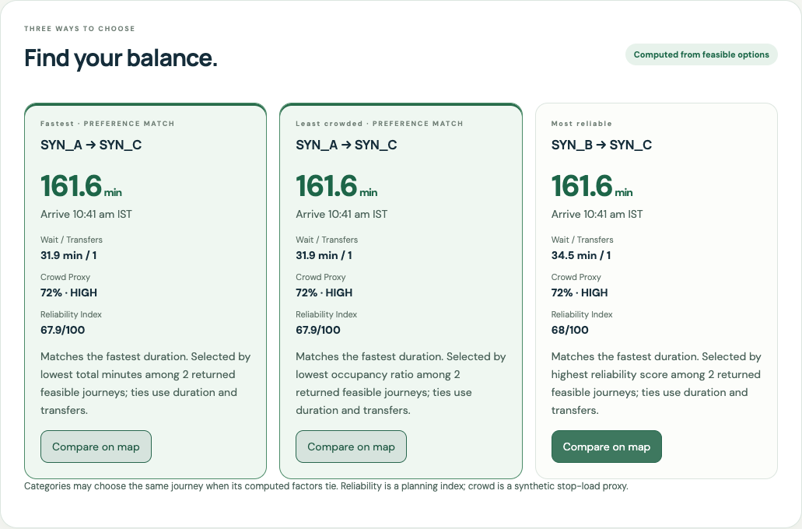
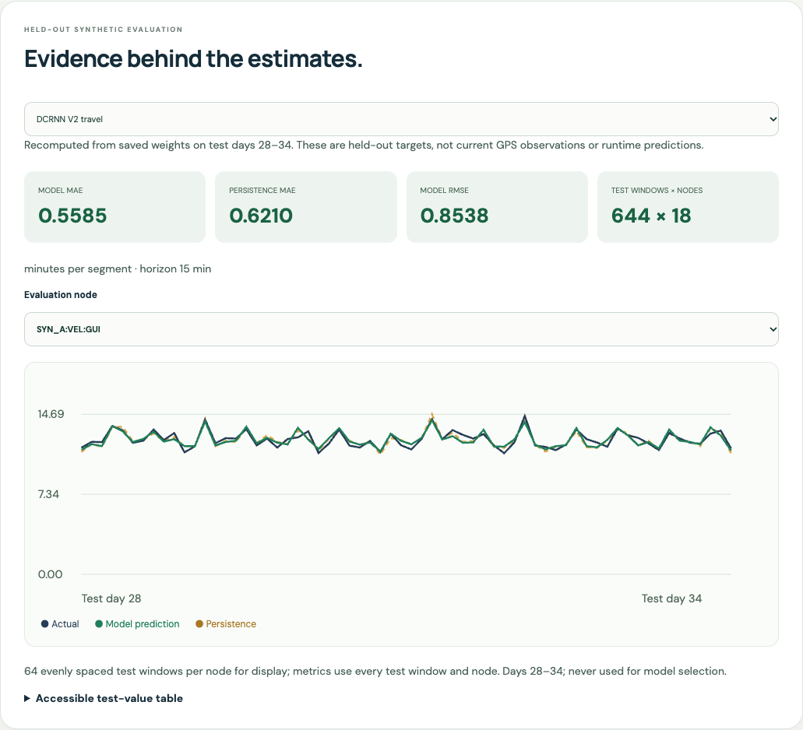
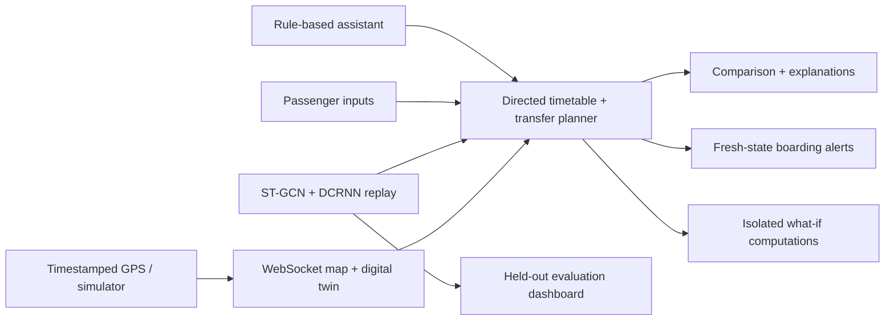

# BusSure — Explainable AI Journey Planning

A public transport planning showcase built with **FastAPI, React, Leaflet, ST-GCN and DCRNN V2**. Compare journeys, follow a network digital twin, explore what-if scenarios and inspect the evidence behind each prediction.

**Transparent by design:** Chennai-area services, geometry and training histories are synthetic. GPS sources are labelled individually. Short-horizon model replay is not an official operator feed or real-world validation.

## Explore the application

| Experience | What it does |
|---|---|
| Live Journey Digital Twin | Moving GPS markers, vehicle speed, next stop, nullable arrival estimates, scenario delay and synthetic occupancy proxies |
| Smart Comparison | Computed fastest, least-crowded and most-reliable journeys, preference highlights and understandable trade-offs |
| What-If Studio | Backend-computed traffic, demand, delay and roadblock overlays with before/after results and reset |
| Journey Assistant | Rule-based stop/time/preference extraction, explicit missing-detail prompts and confirmation |
| Model Performance | Held-out actual/predicted/persistence charts, selectable nodes, MAE/RMSE and accessible test-value tables |
| Boarding Alerts | Approaching-bus alerts, major arrival changes and transfer reminders; permission-based browser delivery with in-app fallback |

The original direct/transfer planner, simulator, WebSocket resync, physical-device sender, baseline experiments and historical Salvador model demo remain available.

## Screens from the tested application





[What-if studio](docs/verification/showcase-studio.png) · [Digital twin](docs/verification/showcase-twin.png) · [Mobile layout](docs/verification/showcase-mobile.png)

## Run locally

From the project root, install dependencies if needed:

```sh
python3 -m venv .venv
.venv/bin/python -m pip install -r backend/requirements.txt
.venv/bin/python -m pip install -r ml/synthetic/requirements.txt
```

Use three terminals:

```sh
# 1. Backend
GTFS_DIR=datasets/synthetic_chennai .venv/bin/python -B -m uvicorn app.main:app --app-dir backend --port 8000
```

```sh
# 2. Six simulated GPS vehicles
.venv/bin/python -B simulator/multi_bus_simulator.py --config datasets/synthetic_chennai/simulator.json
```

```sh
# 3. Frontend
cd frontend
npm ci
npm run dev
```

Open **http://localhost:5173** → Start journey → AI Journey. Try `Take me to Stop G at 08:00 with low crowd and fewer transfers.` and choose Madipakkam when asked for an origin. Use Digital Twin and Model Insights from navigation. Studio previews need a planned journey first.

## Reproducible AI

| Synthetic-trained model | Held-out MAE | Persistence MAE | Forecast horizon |
|---|---:|---:|---|
| Seven-stop ST-GCN | 0.012526 occupancy ratio | 0.014889 ratio | Next 5-minute slot |
| 18-segment DCRNN V2 | 0.558525 minutes per segment | 0.620956 minutes | Next 15-minute slot |

Model selection uses validation days; evaluation uses separate test days 28–34. Whole-journey use holds these short-horizon forecasts fixed as explicit scenario assumptions. Original historical research metrics remain separate.

The showcase does not retrain or change these weights. To reproduce the existing dataset and models from scratch:

```sh
.venv/bin/python scripts/generate_synthetic.py
.venv/bin/python -B -m ml.synthetic.train --epochs 18
```

## Verification

```sh
.venv/bin/python -B -m unittest discover -s backend/tests -v
.venv/bin/python -B -m unittest ml.travel_time.dcrnn_v2.test_pipeline ml.travel_time.dcrnn_v2.test_sunt ml.synthetic.test_retraining -v
node scripts/test_phone_page.js
cd frontend
npm test
npm run build
```

Latest verified results: **82 backend tests, 8 ML/retraining tests, 15 frontend tests, 8 Chrome acceptance tests, 7 mocked phone-page scenarios, and a successful production build**. Browser tests use separate synthetic and SAMPLE servers; exact commands and scope are in the [showcase report](docs/showcase_report.md).

## Architecture and documentation



[Startup guide](docs/synthetic_end_to_end.md) · [Showcase guide](docs/showcase.md) · [Implementation/test report](docs/showcase_report.md) · [Architecture](docs/architecture.md) · [Model integration](docs/model_integration.md) · [Datasets](docs/datasets.md) · [API reference](docs/api_reference.md)

This is a local, single-worker prototype. Real-road routing, live operational temporal feeds, calibrated uncertainty, authentication, persistence and physical-phone validation remain outside the verified scope. Browser notifications require permission and do not run as background push. No LinkedIn or GitHub publication is performed automatically.

<details>
<summary>Preserved earlier-stage instructions and historical demonstrations</summary>

## Chennai question-answer demonstration (fictional)

After submitting a supported demo journey, the two cards share an illustrative Leaflet map. Use **Highlight on map** or click a route line to select it. Start/destination markers and animated simulated bus dots are shown; **Pause simulated buses** stops the animation. Paths are straight-line connections between approximate demo anchors—not road geometry or verified stops. Animation loops at a presentation speed unrelated to the displayed scenario times, and never enters the backend GPS store. Background tiles need internet; lines and markers remain available without them.

Presentation flow: open **AI Journey**, enter starting location and destination, choose **Faster journey**, **Less crowd** or **Less delay**, then click **Suggest my journey**. Presets `Madipakkam → Chennai Central` and `Chennai → Kanchipuram` each offer two fictional routes. Cards display fixed simulated crowd, delay, ride, wait, walk and total minutes; the recommendation changes with preference. Total includes delay exactly once. These are scripted presentation scenarios, not geography-derived estimates, trained-model predictions, or real services. Other pairs only work when present in the small demo fixture. The actual historical checkpoint demo is collapsed in the technical appendix.

On **AI Journey**, use **Ask BusSure · Fictional Chennai demo** and ask `From Madipakkam to Chennai Central` or `From Chennai to Kanchipuram`. This works without any Tamil Nadu dataset. The JSON fixture at `backend/app/data/chennai_demo.json` uses real place names but entirely fictional route IDs and stop sequences. It is isolated from the real GTFS planner, map and bus state. Reverse journeys and unknown places return an explicit no-demo-option message. The parser supports the displayed `From … to …` format, not general conversation.

`POST /api/demo/journey` accepts `{"question":"From Madipakkam to Chennai Central"}`. Responses contain labelled demo routes and a text reply, with ETA and crowd set to null. This reply is deterministic fixture lookup, **not DCRNN-generated language or a valid Chennai prediction**. The actual historical DCRNN demonstration remains separately available below it. Restart FastAPI and reload the frontend after updating.

## Historical DCRNN demo

Open the passenger app, enter the workspace, select **AI Journey**, then click **Run historical model demo**. This executes the existing DCRNN V2 checkpoint against its saved June 2, 2024 Salvador, Brazil observations and checks predictions against the training-time reference. It displays nine segment durations, named stops, observed-input counts and explicit historical labels. It does **not** predict your selected Tamil Nadu journey, waiting time, crowd, or live ETA. Existing origin/destination search is unchanged.

The backend's Python environment needs the optional model dependencies (already present in this workspace):

```sh
.venv/bin/python -m pip install -r ml/travel_time/dcrnn_v2/requirements.txt
curl --fail http://localhost:8000/api/models/historical-demo
.venv/bin/python -B -m unittest discover -s backend/tests -v
```

Restart the backend after pulling changes. Run the backend and frontend with the commands below. No training or download is performed by the endpoint. Inference runs in a short-lived CPU subprocess with a 60-second timeout; successful results are cached until backend restart. Concurrent inference requests receive a retryable 503; missing dependencies/artifacts or failed reference verification also return 503 without disabling GPS. This demo uses only its bundled historical feed and does not replace the active GTFS. ST-GCN is not integrated: matching inference implementation and occupancy inputs are still needed.

Stage 2 adds the React/Leaflet passenger map, GTFS destination search, direct journey options and live bus comparison. See [Stage 2 run and test instructions](docs/stage2_passenger.md) and the [Stage 2 audit](docs/stage2_audit.md). The GPS/networking system below remains in use.

From the project root, use three terminals:

```sh
# Terminal 1 — sample fallback only when real GTFS is unavailable
GTFS_SAMPLE=1 .venv/bin/python -B -m uvicorn app.main:app --app-dir backend --port 8000

# Terminal 2 — simulated buses
.venv/bin/python -B simulator/multi_bus_simulator.py

# Terminal 3 — passenger UI
cd frontend
npm ci
npm run dev
```

Open **http://localhost:5173**. Allow your location, then select a GTFS destination suggestion. If your GPS is outside the fictional sample area, expand **Try a sample journey** and use **SAMPLE Central** as a visibly labelled test origin. Set the walking radius to **500 m**: **SAMPLE East** demonstrates one route with separate buses; **SAMPLE North** demonstrates two routes. No arrival-time, crowd or delay predictions are generated.

The original GPS device remains at `http://localhost:8000/gps-device`; the passenger page never posts coordinates to `/api/buses/location`.

The networking foundation accepts `REAL_PHONE_GPS` and `SIMULATOR` updates in one FastAPI process. It includes GTFS lookup, nearby stops, approximate walking time, stop progression, incremental WebSocket updates, and network-event creation/clearing. No ML, ETA/crowd prediction or official live operator feed is implemented. See [the networking-stage audit](docs/gps_networking_audit.md) for its historical coverage and verification limitations.

## Run the sample milestone

Run all commands from the BusSure project root. Python 3.9+ is supported by the dependency bounds; this checkout was tested with Python 3.9.6. A project-local `.venv` is already installed in this workspace. On a fresh checkout:

```sh
python3 -m venv .venv
.venv/bin/python -m pip install -r backend/requirements.txt
```

Terminal 1 — backend using explicitly fictional sample GTFS:

```sh
GTFS_DIR=simulator/routes/sample_gtfs GTFS_SAMPLE=1 \
  .venv/bin/python -B -m uvicorn app.main:app --app-dir backend --host 127.0.0.1 --port 8000
```

Use one worker: the store and WebSocket subscribers live in one process. Restarting clears all bus state. API documentation: http://127.0.0.1:8000/docs.

Terminal 2 — six simultaneous simulated buses, two on each of three SAMPLE routes:

```sh
.venv/bin/python -B simulator/multi_bus_simulator.py
```

Expected simulator output (coordinates change on each tick):

```text
SIMULATED ONLY: 6 buses. No official live positions.
SIMULATED BUS_001 13.000000, 80.000500
SIMULATED BUS_002 13.000000, 80.004500
SIMULATED BUS_003 12.996000, 80.005000
SIMULATED BUS_004 13.001000, 80.005000
SIMULATED BUS_005 13.000000, 80.001013
SIMULATED BUS_006 13.000065, 80.005000
```

`simulator/simulator_config.json` controls bus IDs, GTFS route/trip IDs, speeds in metres/second, starting progress, update interval and stop dwell time. Coordinates interpolate straight lines between sample stops, not roads. Buses visit stops in sequence, dwell, then reset to the first stop after the terminal for another demo cycle. `current_stop_id` means current/most recently reached stop. Each of the six buses has a distinct SAMPLE trip ID; trips on the same route share a stop pattern. These are not actual operator assignments. `--ticks 3` runs a finite demo. GPS source is always `SIMULATOR`, even if you configure the simulator with real GTFS.

## REST tests

```sh
curl -s http://127.0.0.1:8000/api/health
curl -s http://127.0.0.1:8000/api/buses
curl -s http://127.0.0.1:8000/api/buses/BUS_001
curl -s http://127.0.0.1:8000/api/routes/SAMPLE_R1/buses
curl -s 'http://127.0.0.1:8000/api/stops/nearby?latitude=13&longitude=80&radius=1500&limit=5'
curl -s http://127.0.0.1:8000/api/routes/SAMPLE_R1
curl -s http://127.0.0.1:8000/api/routes/SAMPLE_R1/stops/SAMPLE_E/approaching
curl -s 'http://127.0.0.1:8000/api/routes/nearby?latitude=13&longitude=80&radius=1500'
curl -s http://127.0.0.1:8000/api/stops/SAMPLE_C/routes
curl -s http://127.0.0.1:8000/api/trips/SAMPLE_T1/stops
curl -sG http://127.0.0.1:8000/api/routes/connections \
  --data-urlencode 'origin=SAMPLE West' --data-urlencode 'destination=SAMPLE East'
```

Post a manually generated SAMPLE update (not real phone GPS):

```sh
curl -s -X POST http://127.0.0.1:8000/api/buses/location \
  -H 'Content-Type: application/json' \
  -d "{\"bus_id\":\"CURL_SAMPLE\",\"route_id\":\"SAMPLE_R1\",\"trip_id\":\"SAMPLE_T1\",\"latitude\":13.0,\"longitude\":80.0,\"speed\":0,\"timestamp\":\"$(date -u +%Y-%m-%dT%H:%M:%SZ)\",\"source\":\"SIMULATOR\",\"status\":\"STOPPED\"}"
```

Example bus object (timestamps are illustrative):

```json
{
  "bus_id": "BUS_001", "route_id": "SAMPLE_R1", "trip_id": "SAMPLE_T1",
  "latitude": 13.0, "longitude": 80.0005, "speed": 7.0,
  "heading": 90.0, "accuracy": null, "accuracy_meters": null,
  "current_stop_id": "SAMPLE_W", "next_stop_id": "SAMPLE_C",
  "timestamp": "2026-10-03T08:00:00Z", "source": "SIMULATOR",
  "status": "MOVING", "last_received_at": "2026-10-03T08:00:00Z",
  "received_at": "2026-10-03T08:00:00Z",
  "route_verified": true, "route_data_source": "SAMPLE",
  "stop_sequence_index": 0, "revision": 1
}
```

`route_verified` only means the route/trip pair exists in the loaded data; it does not verify operator identity or whether that service runs today. No real Tamil Nadu route number is hard-coded.

## WebSocket test

Terminal 3:

```sh
.venv/bin/python -B scripts/watch_buses.py
```

The first message is `{"type":"ready","snapshot_url":"/api/snapshot","epoch":"...","revision":0}`. Data messages contain `type`, `epoch`, `revision`, and either one `bus` or one `event`. The supported data types are `BUS_LOCATION_UPDATED`, `BUS_STATUS_CHANGED`, `NETWORK_EVENT_CREATED`, and `NETWORK_EVENT_CLEARED`. Stop with Ctrl+C.

The viewer script implements reconnect with bounded backoff and resync. Connect first, then fetch `/api/snapshot`, which atomically returns all buses (including stale), all events (including cleared), the server epoch and global revision. Replace your local state with that snapshot. Discard queued messages at or below its revision; apply subsequent revisions in order. If the epoch changes, a revision is skipped, or a `resync_required` control message arrives, fetch another snapshot. Reconnect and repeat after connection loss. This prevents old movement updates from overriding a newer stale status even when GPS timestamps match. Each connection has a bounded queue; slow clients are told to resync. GPS ingestion uses REST; this socket is a viewer stream, not a durable replay log.

Stop the simulator and wait 45 seconds: `/api/buses` excludes its stale buses. Inspect them with:

```sh
curl -s 'http://127.0.0.1:8000/api/buses?include_stale=true'
curl -s http://127.0.0.1:8000/api/buses/BUS_001
```

Configure `BUS_STALE_SECONDS=10` on the backend command to test faster. Statuses are `MOVING`, `STOPPED`, and `STALE`. Staleness uses the device's actual fix timestamp, not merely receipt time. An exact retry is acknowledged idempotently without refreshing its timestamp, receipt time, revision, or freshness. Older or conflicting same-timestamp updates and timestamps over 10 seconds in the future return 409. Devices should have automatic date/time enabled.

Legacy ingestion values `real_phone` / `simulated`, lowercase movement statuses, and `accuracy_meters` remain accepted. Responses always use canonical source/status values and include `accuracy` / `last_received_at`, with `accuracy_meters` / `received_at` retained as compatibility aliases. The legacy `/health` and `lat`/`lon` query parameters also remain supported. WebSocket viewers must use the new named event types and revision protocol.

## Network events

Create an event while the WebSocket viewer is running:

```sh
curl -s -X POST http://127.0.0.1:8000/api/network-events \
  -H 'Content-Type: application/json' \
  -d "{\"event_id\":\"DEMO_BLOCK_001\",\"event_type\":\"ROAD_BLOCK\",\"latitude\":13.0,\"longitude\":80.005,\"route_id\":\"SAMPLE_R1\",\"severity\":\"HIGH\",\"start_time\":\"$(date -u +%Y-%m-%dT%H:%M:%SZ)\",\"description\":\"SAMPLE test road block\"}"
curl -s http://127.0.0.1:8000/api/network-events
curl -s -X POST http://127.0.0.1:8000/api/network-events/DEMO_BLOCK_001/clear
curl -s 'http://127.0.0.1:8000/api/network-events?include_cleared=true'
```

Creation returns 201 and broadcasts `NETWORK_EVENT_CREATED`; clearing returns 200 and broadcasts `NETWORK_EVENT_CLEARED`. Clearing twice is idempotent. Duplicate IDs return 409, unknown clear IDs return 404, invalid schema fields return 422. Route/trip references are checked when GTFS is loaded. Supported types: ROAD_BLOCK, ACCIDENT, DIVERSION, CONGESTION, OTHER. Optional severity: LOW, MODERATE, HIGH, CRITICAL. Optional `trip_id`, `segment_id`, and timezone-aware `end_time` are supported. Events automatically clear when their end time passes. A future `start_time` represents a scheduled event; consumers must respect the time window. Manual clear cancels the event without rewriting its planned time window. Event state is in-memory.

The simulator polls events and passes matching active events to `simulator/network_event_hook.py`. Its default hook observes events but does not change movement. Future slowdown, stopping or diversion logic can be added there without changing GPS networking. No ML delay is invented.

## Real phone GPS

The page is `gps_device/index.html`, served at `/gps-device` by FastAPI. On the Mac you can open http://localhost:8000/gps-device. On a phone use trusted HTTPS; opening the file directly or an HTTP LAN IP will not provide a reliable geolocation setup. [Browser geolocation requires a secure context and permission](https://developer.mozilla.org/en-US/docs/Web/API/Geolocation/watchPosition).

For local Wi-Fi testing, one option is a locally trusted certificate using [mkcert](https://github.com/FiloSottile/mkcert). These optional setup commands were not executed by the project:

```sh
brew install mkcert
mkcert -install
mkdir -p .certs
# Replace 192.168.1.20 with your Mac's Wi-Fi IP from System Settings → Wi-Fi → Details.
mkcert -cert-file .certs/local.pem -key-file .certs/local-key.pem localhost 127.0.0.1 192.168.1.20
mkcert -CAROOT
```

Copy only `rootCA.pem` from the printed CA directory to your phone and install/trust it. On iOS install the downloaded profile, then enable full trust under Settings → General → About → Certificate Trust Settings. On Android install it as a CA certificate through device security settings; exact labels vary. Never share `rootCA-key.pem`. The browser must trust the certificate without an interstitial. Keep the phone and Mac on the same Wi-Fi and permit the local server through the Mac firewall.

To find the Mac IP in Terminal, run `networksetup -listallhardwareports`, locate the device listed under Wi-Fi (often `en0`), then run `ipconfig getifaddr en0` using that device name. Use the resulting address both in the certificate command and the phone URL. If the IP changes, generate a matching certificate. `--host 0.0.0.0` below makes FastAPI listen on the Mac's network interfaces; `0.0.0.0` is not the address to enter on the phone. Do not disable TLS checks or browser geolocation security.

Stop Terminal 1's HTTP server and restart the SAME backend with TLS:

```sh
GTFS_DIR=simulator/routes/sample_gtfs GTFS_SAMPLE=1 \
  .venv/bin/python -B -m uvicorn app.main:app --app-dir backend \
  --host 0.0.0.0 --port 8000 \
  --ssl-certfile .certs/local.pem --ssl-keyfile .certs/local-key.pem
```

Open `https://192.168.1.20:8000/gps-device` on the phone (use your actual IP). Enter `PHONE_001`, a route ID and a trip ID, then Start Tracking and allow location. To use the sample IDs enter `SAMPLE_R1` / `SAMPLE_T1`; the location is still REAL PHONE GPS while the route data remains SAMPLE. For actual supplied GTFS use its IDs. Prototype IDs are accepted but marked unverified.

The page uses `watchPosition()`, sends fresh fixes every three seconds, and displays permission, coordinates, accuracy, heading, speed, successful update count, last fix, last accepted update and connection status. Missing speed/heading remains null. Accuracy worse than 100 metres shows a warning; stop progression is withheld for poor fixes. Network errors retry with bounded backoff, never concurrent uploads; exact retries are safe on the backend. Permanent 409/422 rejection stops tracking with an explanation. Repeated Start clicks cannot create duplicate watchers, and old callbacks cannot affect a restarted session. Keep the page visible and screen awake: browsers can suspend background tracking. Stop Tracking cancels the watcher/uploads; the bus becomes stale after the threshold.

Phone acceptance steps: open the trusted HTTPS URL → enter the three IDs → Start Tracking → grant location → check permission is granted and update count increases → walk a short distance safely → confirm changing coordinates in `/api/buses/PHONE_001` and the WebSocket viewer → keep the simulator running to confirm both source values coexist → Stop Tracking → confirm `PHONE_001` becomes `STALE`. Deny permission once to check the visible error, then re-enable location permission in browser settings. Turning off Wi-Fi briefly checks the connection warning and recovery; fresh GPS fixes are required after reconnection.

To run the simulator at the same time against this TLS server:

```sh
SSL_CERT_FILE="$(mkcert -CAROOT)/rootCA.pem" \
  .venv/bin/python -B simulator/multi_bus_simulator.py --backend https://localhost:8000

# In another terminal, inspect both simulated and phone buses:
curl --cacert "$(mkcert -CAROOT)/rootCA.pem" https://localhost:8000/api/buses

SSL_CERT_FILE="$(mkcert -CAROOT)/rootCA.pem" \
  .venv/bin/python -B scripts/watch_buses.py wss://localhost:8000/ws/buses
```

This is an unauthenticated local prototype: use a trusted development network. Authentication is needed before exposing location ingestion or viewers publicly. A real phone permission/GPS test must be performed on your physical device; automated tests cannot prove its location hardware or browser permissions.

## Real GTFS

Place extracted GTFS text files in `datasets/gtfs/`, then restart without the sample environment variables:

```sh
.venv/bin/python -B -m uvicorn app.main:app --app-dir backend --host 127.0.0.1 --port 8000
```

For this static lookup implementation `routes.txt`, `stops.txt`, `trips.txt` and `stop_times.txt` are required. Agency, calendar and calendar exceptions are loaded when present. Missing data yields 503 for route/stop lookups; GPS still works. `GTFS_SAMPLE=1` permits the labelled bundled sample only when supplied real GTFS is unavailable; supplied files in `datasets/gtfs/` take precedence over a sample request. Partial real feeds report unavailable rather than silently replacing them with sample; malformed feeds fail startup. A `SAMPLE` marker prevents the bundled fixture from being mistaken for actual route data. The loader uses the [GTFS Schedule format](https://gtfs.org/documentation/schedule/reference/), including string IDs and stop order. It is not a complete GTFS validator.

Connections resolve exact stop IDs or case-insensitive stop-name substrings and require origin before destination in the same trip. Pickup/drop-off prohibition value `1` is respected. Calendar data is retained but not evaluated; conditional pickup/drop-off, transfers, natural-language destinations and journey recommendations remain later work. The GTFS service exposes `get_stop`, `get_routes_for_stop`, `get_trip_stop_sequence`, `get_stops_for_route`, `get_routes_between_stops`, and `get_routes_near_location`, using in-memory route/trip/stop indexes and streamed CSV reads. Stop-time rows retain only needed fields.

For verified phone trips, the first fix within `STOP_RADIUS_METERS` (default 40) of a GTFS stop establishes current/next stop. Reaching the next stop advances the sequence. Weak fixes above `MAX_STOP_ACCURACY_METERS` (default 100) do not advance it. Until a stop match exists, stop IDs remain null. Unknown route/trip pairs are explicitly unverified. Simulator stop hints must be adjacent in the supplied GTFS sequence. Phone matching is conservative: it does not infer missed stops, distinguish overlapping loop occurrences reliably, or perform road map matching.

`GET /api/routes/{route_id}/stops/{stop_id}/approaching` orders active, associated upstream buses by remaining straight-line stop-chain distance. This provides a next-bus comparison for the same route, not a guaranteed arrival order or ETA. Buses with unknown progression or already at/past the target are excluded; service calendars and traffic are not evaluated.

Passenger coordinates enter `/api/stops/nearby` as `latitude`, `longitude`, `radius` (metres) and `limit` (1–200, default 20); legacy `lat`/`lon` also work. Results include stop ID/name/coordinates, `distance_meters`, and `estimated_walking_minutes`, nearest first. Haversine supplies distance; walking minutes use `distance / WALKING_SPEED_MPS / 60` (default 1.4 m/s). Both are approximations, not pedestrian network routing. Passenger queries never create bus records and are not stored. The passenger browser UI is outside this milestone.

## Files and extension points

- `backend/app/api/`: REST validation and response boundaries.
- `backend/app/services/`: GPS ingestion, in-memory state, GTFS indexes and nearby-stop calculations.
- `backend/app/websocket/`: bounded client queues and incremental broadcasts.
- `backend/app/schemas/`: location, bus, stop and future `NetworkEvent` contracts.
- `simulator/`: configurable synthetic vehicle movement and labelled sample GTFS.
- `gps_device/`: standalone phone GPS sender, served from the backend origin.
- `datasets/gtfs/`: user-supplied actual route data, ignored by Git.
- `scripts/` and `backend/tests/`: network smoke test, WebSocket viewer and automated tests.
- Existing `frontend/`, `ml/` and unused earlier placeholders are preserved for later milestones.

The in-memory state retains stale buses and cleared events until restart. Long-running production retention, authentication, multi-process storage, road-aware routing and actual simulator disruption reactions remain future work.

## Verification

```sh
.venv/bin/python -B -m unittest discover -s backend/tests -v
node scripts/test_phone_page.js
```

With a fresh sample HTTP backend and no other simulator running (use `BUS_STALE_SECONDS=5` on its startup command for a faster check):

```sh
.venv/bin/python -B scripts/smoke_network.py
# For a backend on a different port:
.venv/bin/python -B scripts/smoke_network.py --backend http://127.0.0.1:8011
```

The smoke test starts six buses, verifies changing REST/WebSocket positions, submits a clearly named `PHONE_PAYLOAD_TEST` synthetic fixture to exercise the phone protocol, verifies source coexistence, creates/clears an event and checks broadcasts, waits for actual automatic stale transitions, then reconnects and checks the snapshot. The synthetic phone fixture is not observed physical GPS. Run against a fresh development server; the test records persist until that server restarts. The Node test uses browser/GPS doubles and requires only Node's built-in modules, not npm packages.


</details>
