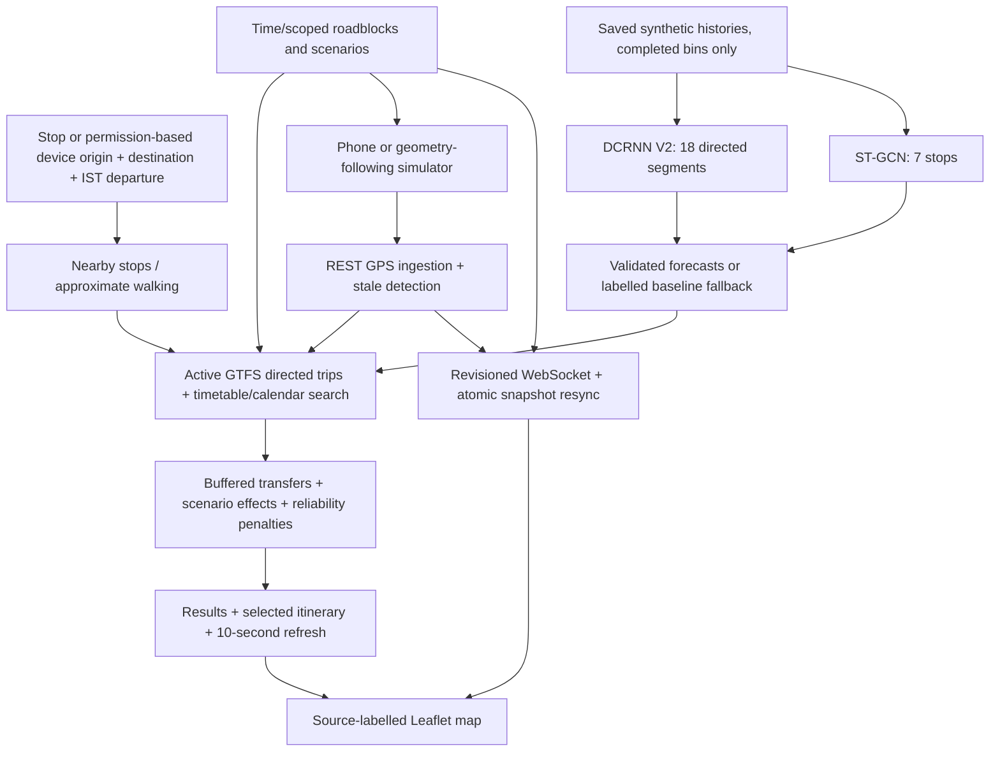

# BusSure architecture

BusSure extends the existing FastAPI, React/Leaflet and single-process WebSocket prototype. Original GPS, GTFS, baseline and historical-demo APIs remain available. The integrated planner is `/api/ai/journeys`; its UI is AI Journey / My Journey / Model Insights.

`backend/app/api/ai.py` validates input and the active network, snapshots bus/event records on the event loop, and runs inference and bounded search in a worker thread. Models load lazily on CPU; artifact, graph, scaler and feature validation precede inference. GPS ingestion and event broadcasts retain their event-loop mutation model. No model training runs during requests.

`ai_journey_service.py` enumerates simple directed paths with at most three ride legs, no repeated route or visited stop, and at most 5,000 search expansions. It evaluates scheduled departures at or after readiness, applicable service dates, pickup/drop-off constraints, a configurable 2–30 minute transfer buffer, and walks up to 500 m by default. At most 12 distinct ranked options are returned. This is a bounded demonstration planner, not a general city-scale optimal routing engine.

Fresh upstream GPS fixes may replace scheduled boarding when the ready time is within 15 minutes of server time. Remaining segment duration is the forecast multiplied by the remaining straight-line fraction; full downstream segments and a 30-second intermediate-stop dwell assumption are added. Weak fixes, passed stops, stale timestamps, and blocked upstream segments are excluded. This is conservative approximate matching, not road map matching. Future searches use timetable boarding estimates.

Short-horizon forecasts are held fixed across a whole itinerary as a stated planning assumption. Every ride segment adds 30 seconds of stop dwell. Wait includes transfer buffers exactly once; total = walking + waiting + ride. The calendar implementation evaluates this generated daily service through 2027-12-31, with exception support in the search. Legacy GTFS-only APIs retain their previous limitations.

## Disruption policy

`disruption_service.py` is shared by the planner and simulator. Windows are start-inclusive/end-exclusive. Planning checks overlap with the nominal segment interval, conservatively applying the selected factor to the whole segment; it does not integrate a time-varying traffic curve within a segment. Route, trip and segment scopes are intersected; segment IDs are `route_id:from_stop:to_stop`. Location-only events affect a 500 m corridor around a segment. Roadblocks and breakdowns stop vehicles and exclude affected planned segments. Other events multiply travel time by LOW 1.1, MODERATE 1.3, HIGH 1.6 or CRITICAL 2.0; overlapping multipliers use the maximum. Crowd surges add 0.2 occupancy ratio each, capped at 0.4 extra and 1.0 final occupancy. Upstream disruption delays shift scheduled boarding times where applicable. Scenario changes are synthetic assumptions, not learned causal effects. No diversion geometry is invented.

## Reliability and ranges

The reproducible index is `max(0, 100 - D - T - B - E - G)`:

- D = min(35, 1.5 × delay minutes above schedule).
- T = 8 × number of transfers.
- B = 3 × transfers × max(0, 5 − configured transfer buffer).
- E = min(25, 8 × number of distinct affecting disruptions).
- G = 0 when a qualifying GPS bus is associated, otherwise 5.

This is an explainable planning index, not an on-time probability. Delay risk is LOW up to 5 min, MEDIUM above 5 through 15, HIGH above 15. Transfer risk is NONE for direct journeys, HIGH below a 5-min buffer, otherwise MEDIUM. The deterministic scenario range is nominal duration through nominal + 20% of ride time + one extra configured buffer per transfer. It is not a confidence interval.

State, selected UI journeys and scenario events are not persisted through process/page restarts. Run one backend worker. Authentication, multi-process durable storage and production retention remain outside this local prototype.

## Showcase layer

`api/showcase.py` adds twin, assistant, what-if and evaluation routes. Event-loop snapshots precede CPU work in worker threads. `showcase_service.py` enriches normal results with computed comparison winners and applies copied, route-specific scenario overlays. `evaluation_service.py` evaluates unchanged graph models against held-out targets; cached outputs are separate from runtime forecasts. `assistant_service.py` returns explicit rule-based interpretation for user confirmation.

React `ShowcasePanels.jsx` consumes those APIs, while existing WebSockets continue to animate GPS markers. Twin cards combine fresh fixes with five-second estimate snapshots and hide predictions when the next-stop association no longer matches. `boardingAlerts.js` is a pure timestamp/deduplication engine. In-session memory survives screen navigation; optional browser delivery is permission-gated, with in-app fallback. No new production storage or external messaging service is introduced.
